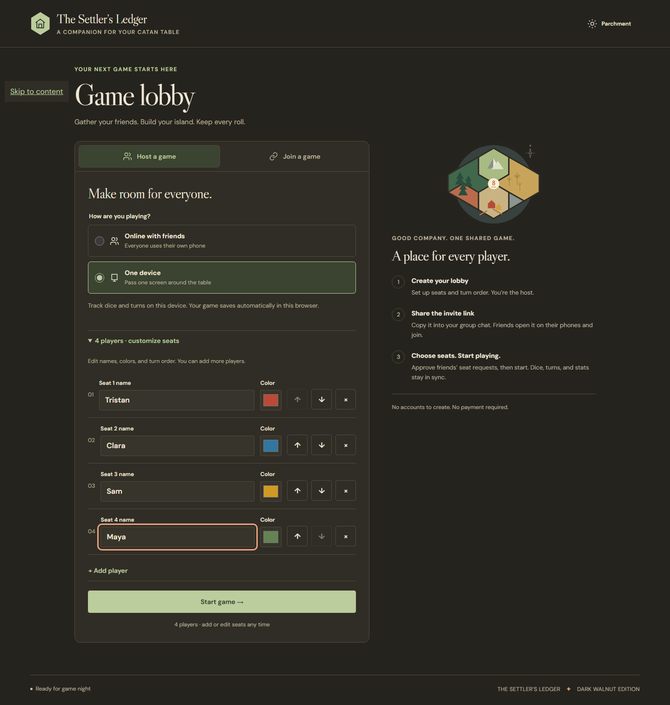
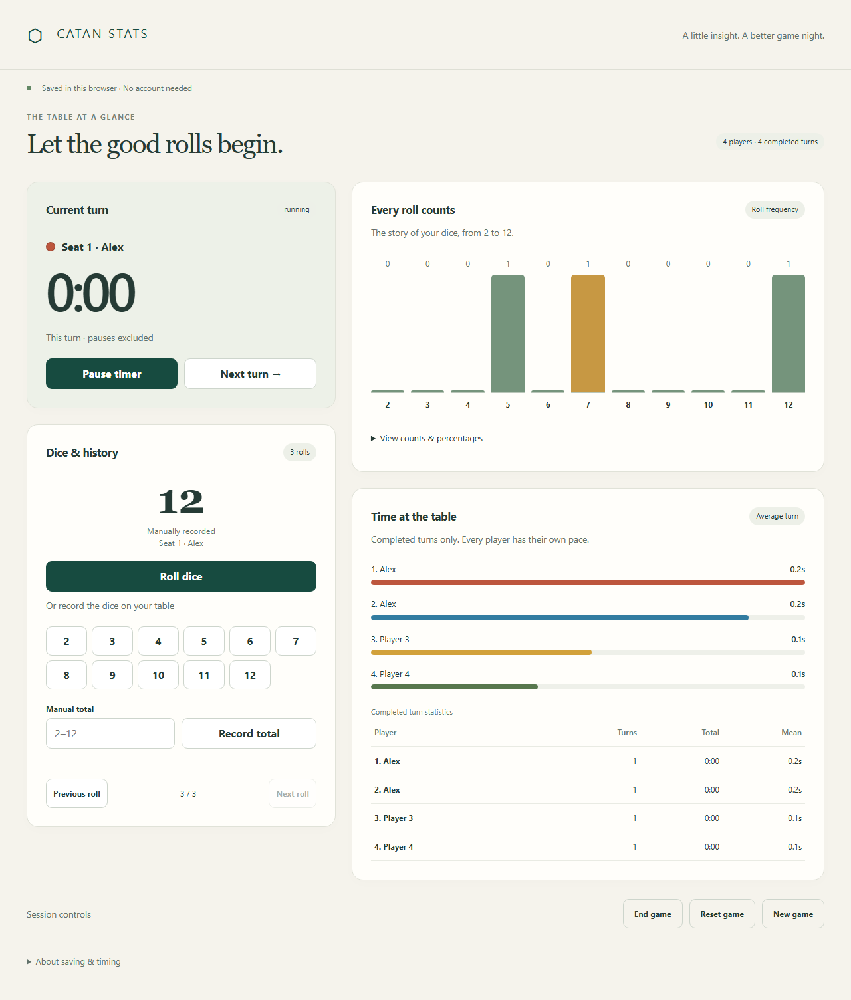

# Catan Stats Web

A responsive, browser-local companion for dice rolls and turn timing at a physical game table. Start with four players; add as many as your table needs. Names (1–40 characters), colors, and order are editable during setup. Duplicate names stay distinct by seat and stable ID.

## Run

Use Node **24.20.0** (also pinned in `.nvmrc`). From this repository:

```sh
npm ci
npm run dev
```

Open `http://localhost:5173/catan-stats-web/`. On Windows PowerShell with script execution disabled, use `npm.cmd` and `npx.cmd` in place of `npm` and `npx`.

```sh
npm run typecheck
npm run lint
npm test
npm run build
npx playwright install chromium
npm run test:e2e
npm run preview
```

Browser tests run against the production build at `http://127.0.0.1:4173/catan-stats-web/`. They cover desktop and phone layouts. CI repeats installation, type checking, lint, unit/component tests, build, and browser tests.

## Playing

Generated rolls tumble two dice for about half a second, then reveal their final faces and sum. The result is recorded once at click time; animation cannot add rolls. Manual entries give brief feedback and history navigation stays immediate. Reduced-motion preferences skip the animation.

- Start game snapshots the roster; **Start timer** begins timing separately.
- Roll two independent dice, enter a whole total from 2 to 12, or use quick-entry buttons. Dice entries never advance a turn or start timing.
- Pause/resume excludes paused time. **Next turn** completes the current turn and starts the next player immediately, including when advancing from pause.
- Browse previous rolls without changing statistics. A new roll always selects the latest history entry.
- Statistics show all eleven totals, counts and percentages, plus each seat’s completed-turn count, total time, and arithmetic mean. Unfinished turns appear only in the live timer.
- End, Reset, and New game require confirmation. Reset retains the roster; New game makes it editable again.

## Saving and timing

One session is autosaved after each game change in `localStorage`, under `catan-stats.session.v1`. It belongs to this browser and origin: clearing browser data removes it, and a different device, browser, or origin has separate data. Setup drafts are saved only when the game starts.

Running timers include wall-clock time while a tab is hidden or closed. Paused timers remain unchanged. Display refreshes do not drive timing or trigger save writes. Manual system-clock changes can affect elapsed time; negative segments are clamped to zero.

Unreadable or unsupported saves are preserved until explicitly discarded. Storage failures leave the app usable in memory with a visible warning. Another tab’s update stops automatic writes in the stale tab until reload. A pre-write comparison also catches changes before a storage event arrives. Truly simultaneous cross-tab play is unsupported; localStorage cannot provide a multi-tab transaction.

## Static hosting

`npm run build` produces the standalone `dist/` directory, with no server or source checkout needed at runtime. Vite’s base is `/catan-stats-web/`, ready for a GitHub Pages project site of that name. Publish the **contents** of `dist/` to that path. For a root-domain host, change `base` in `vite.config.ts` to `/` and rebuild. Preview and browser tests verify the configured subpath. No remote repository or public deployment is created by this implementation.

## Windows double-click launcher

Double-click **Catan Stats.exe** in the repository folder. It starts a server available only on this computer and opens the default browser at **http://127.0.0.1:4175/catan-stats-web/**. The executable embeds the entire built app; you can copy it elsewhere and run it without Node, npm, or the repository. It uses Windows .NET Framework 4.5 or newer (included in Windows 10/11).

The launcher remains in the notification area. Double-click its tray icon to reopen the app, or right-click and choose **Exit / stop server**. Closing the browser does not stop the server. Launching the executable again opens the same address instead of creating a second server. If another program occupies port 4175, it reports an error rather than choosing a different origin and making saves appear lost.

Launcher saves belong to the fixed `127.0.0.1:4175` origin, separate from development/preview saves at ports 5173/4173. Always use the launcher address for the same session. The executable is locally built and unsigned.

To rebuild after changing the app, on Windows:

```sh
npm run build:exe
npm run test:exe
```

Exit a running launcher before rebuilding/testing it. `build:exe` builds the web app and compiles `launcher/Launcher.cs` using the Windows .NET Framework compiler. Generated binaries and embedded archives are ignored by Git. `test:exe` starts it without opening your default browser, checks its embedded app in Chromium, verifies a second launch, and stops its test server.

## Structure and scope

`src/domain` holds pure, timestamp-injected transitions, dice generation, and selectors. `src/storage` validates versioned saves and guards writes. `src/app` composes setup, dashboard, accessible native confirmation dialogs, and session lifecycle; `src/styles` supplies responsive CSS. Tests live in `tests/` and `e2e/`.

There are no accounts, cloud synchronization, past-game library, scoring, export, or offline/PWA support. Modern browsers with native dialog support are required. Automated browser verification uses Chromium with desktop and phone viewports, not physical iOS devices.

## Screenshots





## Attribution

Based on [TristanHaHa/catan-stats](https://github.com/TristanHaHa/catan-stats), reviewed at commit `47a4c39616834ed11c7921b062907dbdc24c4f78`. The original **Copyright (c) 2020 Tristan Ha** MIT notice is preserved in [LICENSE](LICENSE). This is an independent React/TypeScript implementation of its interaction intent. The full implementation handoff is in [docs/implementation-plan.md](docs/implementation-plan.md).

Toolchain setup references: [Vite](https://vite.dev/guide/), [React](https://react.dev/learn/creating-a-react-app), [Vitest](https://vitest.dev/guide/), [React Testing Library](https://testing-library.com/docs/react-testing-library/intro/), and [Playwright](https://playwright.dev/docs/intro).
