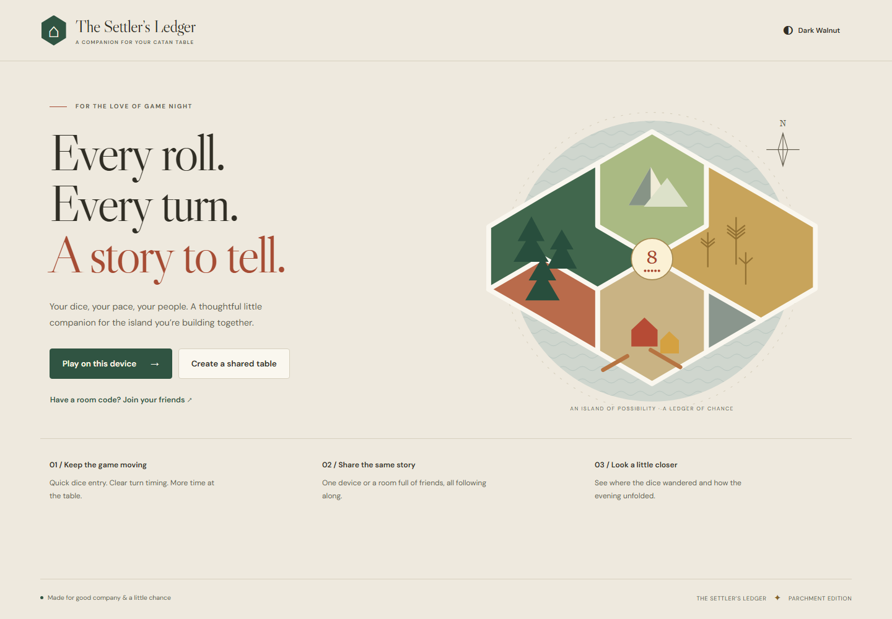
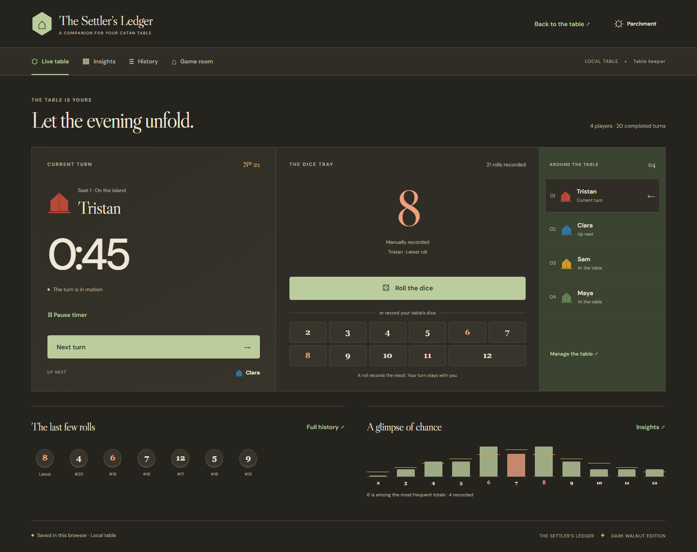

# The Settler’s Ledger · Catan Stats 2.0

A tabletop companion for dice, turn timing, and the story of game night. A new turn-first interface, Parchment and Dark Walnut themes, and optional real-time multiplayer. Original terrain illustration and settlement markers; no official Catan artwork or logo.

Open [The Settler’s Ledger on GitHub Pages](https://tristanhaha.github.io/catan-stats-web/). The shared backend is configured and verified on the free Spark project `catan-65500`, without a billing account. Frontend releases are validated and published by the Pages workflow on pushes to `main`.


## Run and verify

Use Node **24.20.0** (`.nvmrc`). On PowerShell with script execution restrictions use `npm.cmd` / `npx.cmd`.

```sh
npm ci
npm run dev
```

Open [localhost:5173/catan-stats-web](http://localhost:5173/catan-stats-web/).

```sh
npm run typecheck
npm run lint
npm test
npm run build
npx playwright install chromium
npm run test:e2e
# Java 21+ required; uses only demo Firebase emulators, no credentials:
npm run test:multiplayer
```

`npm run screenshots` captures all main local views from a running development server. `LEDGER_CAPTURE_URL` overrides its URL. Screenshot fixtures are created by real UI interactions and remain isolated from your browser's sessions.

## At the table

- **Home:** start local play, create a shared table, join by code/invitation, or resume your local session. The join form remembers the last room code.
- **Lobby / Game room:** four players by default, at least two, with no fixed roster maximum. Edit names (1–40 characters), colors, and order; duplicate names keep distinct IDs. Shared hosts can start with any or all seats unclaimed. Roster additions and reordering during play retain the current turn and all previous records.
- **Live table:** current player, timer, next turn, generated two-dice rolls, one-tap physical-dice totals 2–12, recent rolls, and a small distribution preview. A roll never starts the timer or advances a turn. Start timing separately; Next turn finishes the active turn and starts the next immediately, including from pause. Unclaimed seats are never skipped.
- **Insights:** all totals, observed and expected percentages, actual counts, per-seat completed turn count, total time, and arithmetic mean. Unfinished turns never enter timing statistics. Expected probabilities assume two independent fair six-sided dice.
- **History:** inspect every recorded roll through an eight-entry window, with seat, timestamp, and generated/manual source. Inspection never changes game data. Turn changes and host corrections appear as chronological notes.
- **Host tools:** approved seat assignments/recovery, spectator promotion, membership removal/restoration, player additions, active-player override, roll correction, latest-roll undo, confirmed end/reset/new. Host authority is separate from owning a player seat.
- **Recap:** recorded distribution and timing comparisons after ending. No victory-point or winner inference.

In shared play, only the active seat or host can record rolls and operate turn/timer controls. Waiting players and spectators can view the live table, insights, and history. Guests use anonymous authentication. Joining does not grant seat ownership: request a seat and have the host approve it. Disconnections retain the roster, assignments, and statistics. Host reassignment recovers a seat when a player's browser identity changes.

## Persistence and timing

Local games retain the original validated v1 save under `catan-stats.session.v1`. No data conversion or overwrite is required. New local history notes are additive. Invalid/unsupported saves are kept until explicitly discarded. Storage failures leave play usable in memory with a warning. Competing tabs stop stale autosaves until reload; truly simultaneous localStorage play remains unsupported.

Running timers include real elapsed time while tabs are hidden, closed, or disconnected. Pause explicitly to exclude time. Shared durations use backend timestamps and local displays use a periodically calibrated clock offset; no per-second Firestore writes occur. Presence is approximate and never controls ownership or timing. Multiplayer locks unsupported offline changes and restores authoritative state on reconnect. Uncertain requests have an idempotent retry control.

Local and shared games stay separate: a shared session never replaces the browser-local save. Anonymous identity belongs to the browser; clearing storage loses it. Players can recover through host reassignment. **Losing the host identity has no automatic recovery.** Keep the host browser's data until you finish the game.

## Firebase and security

See [Firebase setup, schema, command protocol, and limitations](docs/firebase-setup.md). Shared play uses anonymous Authentication and Firestore transactions/security rules on **Spark**. No Cloud Functions or billing account is required. Rules validate active-seat rolls/timer transitions, restrict administration to the host, require atomic audit/receipt records, and deny room enumeration. A modified client cannot promote itself or rewrite game history. Native server timestamp segments keep turn durations independent of device clocks.

The production web app, default free-tier database, Authentication, domains, and Firestore rules are configured in `catan-65500`. A real-project two-browser workflow passed with billing disabled. Optional App Check enforcement is not configured. Emulator tests include forged writes, permissions, retries, concurrent commands, corrections, and recovery.

Spark quotas limit availability rather than authorizing paid overages while billing stays unlinked. Presence and spectators consume reads/writes; close rooms when finished. Very long games are bounded by Firestore's 1 MiB document limit. Receipts/audit notes persist until intentional manual cleanup. There is no automated host-identity recovery. See the setup guide for details.

## GitHub Pages deployment

The Vite base remains `/catan-stats-web/`. Invitations use `?room=CODE` on that same static path, so no server routing or rewrite is needed. `npm run build` creates standalone `dist/`, including fonts; publish its **contents** at that project path. For root-domain hosting change `base` in `vite.config.ts` to `/` and rebuild.

`.github/workflows/pages.yml` checks types, lint, unit tests, browser/accessibility tests, and Spark-only emulator integration before publishing the frontend. Public Firebase configuration is tracked in `src/multiplayer/firebase-public.json`; GitHub `VITE_FIREBASE_*` variables can optionally override it. Deploy backend configuration separately with `npx firebase deploy --only auth,firestore --project catan-65500`. No backend deployment step enables billing or deploys Functions.

## Windows launcher

The existing standalone launcher remains supported:

```sh
npm run build:exe
npm run test:exe
```

Exit a running launcher first. The unsigned `Catan Stats.exe` embeds the current frontend and self-hosted fonts, opens `http://127.0.0.1:4175/catan-stats-web/`, and runs from the notification area. Double-click again to reopen; use its tray menu to stop. Node/npm are not needed to run the built executable. Windows .NET Framework 4.5+ is required. Local saves belong to this fixed origin, separately from GitHub Pages and development. A build containing Firebase configuration also needs network access for shared play; local play has no backend dependency.

## Implementation and screenshots

Pure transitions, statistics, and validation live in `src/domain`; guarded local saving in `src/storage`; Firebase adapters and versioned room commands in `src/multiplayer`; Firestore wire encoding/decoding in `src/multiplayer`; presentation in `src/app`. No chart/router/component framework is needed. Firebase is loaded only for shared activity. Fonts are bundled from Fontsource, with their OFL notices in `public/licenses`; the browser makes no Google Fonts request.

The [design assessment and implementation checklist](docs/ledger-plan.md) compares three layout directions and records verification. The [original implementation handoff](docs/implementation-plan.md) is historical; its local-only scope is superseded by this redesign.

| Home | Dark Walnut |
| --- | --- |
|  |  |

Additional captures: [mobile](docs/mobile.png), [setup](docs/setup.png), [insights](docs/insights.png), [history](docs/history.png), [game room](docs/room.png), [recap](docs/recap.png), and [emulator multiplayer](docs/multiplayer.png).

## Attribution

Based on [TristanHaHa/catan-stats](https://github.com/TristanHaHa/catan-stats), originally reviewed at commit `47a4c39616834ed11c7921b062907dbdc24c4f78`. The original **Copyright (c) 2020 Tristan Ha** MIT notice is preserved in [LICENSE](LICENSE). Catan is referenced only to describe compatibility with the physical game; this is an independent companion.
